<table>
<tr>
<td valign="top"></td>
<td valign="top"></td>
</tr>
</table>

## Hi, I'm Raghavendra 👋

**Welcome to my GitHub.** I'm a Computer Science student at Scaler School of Technology and BITS Pilani in Bengaluru.

I like building things end to end: the API, the database, the UI and the part where it gets deployed. Lately I have been working with AI and RAG apps, backend systems in Python and C++, and DevOps. I also solve problems on LeetCode, Codeforces, CodeChef and AtCoder.

## What I'm up to

- Learning DevOps: Docker, Kubernetes, Terraform and CI/CD (my notes are in [devops-2028](https://github.com/Raghavendra1729-cell/devops-2028))
- Writing C++ for competitive programming and for a high frequency trading course
- Mentoring juniors in DSA and OOP as a teaching assistant buddy

## Projects

| Project | What it is |
|---|---|
| [Diablo](https://github.com/Raghavendra1729-cell/Diablo) ([live](https://raghav-1729-diablo-ai-agent.hf.space)) | Voice and chat AI assistant for my portfolio using hybrid RAG, Qdrant and Cal.com interview booking |
| [Portfolio](https://github.com/Raghavendra1729-cell/Portfolio) ([live](https://raghav-1729-portfolio.hf.space)) | Next.js portfolio with a MongoDB backed admin CMS and Cloudinary uploads |
| [SastaNotebookLm](https://github.com/Raghavendra1729-cell/SastaNotebookLm) ([live](https://sasta-notebook-lm-frontend.vercel.app/)) | Upload a PDF or TXT and ask questions about it using Gemini embeddings and Qdrant |
| [Web-Automation-Agent](https://github.com/Raghavendra1729-cell/WEB-AUTOMATION-AGENT) | Agent that looks at screenshots with Qwen2.5-VL and drives Chromium through Playwright |
| [Multithreaded HTTP Server](https://github.com/Raghavendra1729-cell/Multithreaded-Http-Server) | HTTP/1.1 server in plain Python sockets with a thread pool and 54 tests |
| [Typeahead System](https://github.com/Raghavendra1729-cell/Typeahead-System) | Search suggestions with FastAPI, Redis sharding and PostgreSQL |
| [Khaao](https://github.com/Raghavendra1729-cell/Khaao) | Canteen ordering PWA with a Go API, React, PostgreSQL and live order updates |
| [Lost-n-Found](https://github.com/Raghavendra1729-cell/Lost-n-Found) ([live](https://lost-n-found-sandy.vercel.app/)) | Lost and found platform with Google login, image listings and chat |
| [CSES Bookmarker](https://github.com/Raghavendra1729-cell/CSES-BOOKMARKER) | Chrome extension for CSES bookmarks, notes, timers and AI reviews of submissions |
| [PlaceTrack](https://github.com/Raghavendra1729-cell/placetrack-devops-capstone) | My DevOps capstone: a job tracker with Docker, CI/CD, Terraform, Kubernetes and monitoring |
| [PaisaMatch AI](https://github.com/Raghavendra1729-cell/razor_pay-hackathon) | Hackathon project that matches orders, settlements and bank deposits |
| [CSES Solutions](https://github.com/Raghavendra1729-cell/CSES-Solutions) and [templates](https://github.com/Raghavendra1729-cell/templates) | My C++ solutions and contest templates |

You can find the rest of my work in the repositories tab.

